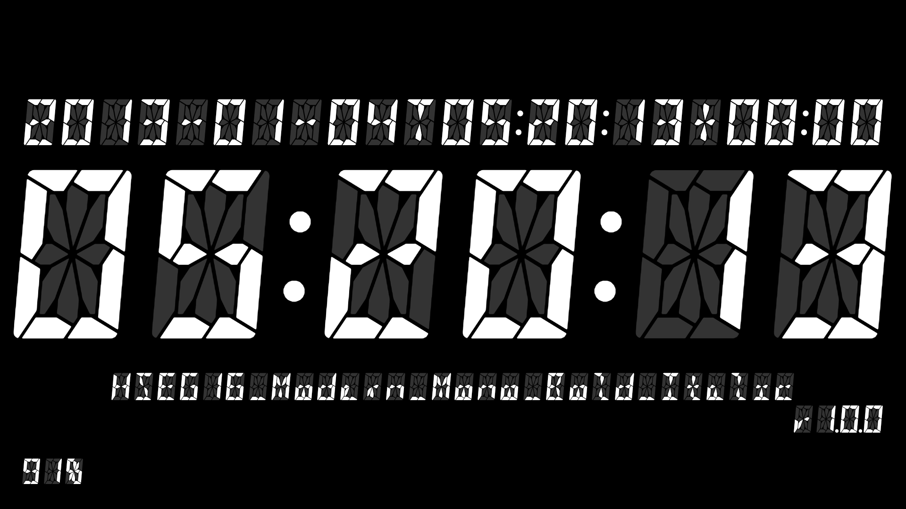

# 时分秒 (HoMiSe)

把 Android 设备变成一台数码管时钟：纯黑底、白色段码字形、`时:分:秒` 占满全屏，离线运行，不申请任何权限。



- **平台**：Android 8.0+（minSdk 26，targetSdk 35）
- **技术栈**：Kotlin · Jetpack Compose · Material 3
- **字体**：HSEG7 / HSEG16 共 48 款，本项目作者基于 DSEG 改造

## 下载

从 [Releases](https://github.com/KuwsSyet9999/HoMiSe-Clock/releases/latest) 下载最新安装包（Android 8.0+），每个包附同名 `.sha256` 校验文件。

## 特性

**布局**

- 字号由「一个冒号的笔迹宽度」反推：横屏看左右、竖屏看上下，四周留白与竖屏行距始终等于冒号宽
- 挖孔屏按安全区自动避让；沉浸式全屏，状态栏与导航栏隐藏，边缘滑动可临时唤出
- 竖屏只显示时钟；横屏额外显示信息提示（ISO 时间、字体全名、版本号、电量）

**字体**

- 48 款：HSEG7（七段）× 24 + HSEG16（十六段）× 24，覆盖 4 族 × 6 字重（含斜体）
- 左右滑动切换字体族，上下滑动切换字重与斜体，选择持久化
- HSEG16 支持小写等宽（Mono）开关，重新分配亮段让笔迹铺满字格

**显示**

- 灰底（熄灭段）开关：开启时未点亮的段以灰色衬底显示；关闭后只剩亮段
- 黑白配色互换：黑底白字 ⇄ 白底黑字
- 长按背景切换最高亮度，只作用于本窗口，不改系统设置
- 屏幕常亮，冒号每秒闪烁

**信息与交互**

- 单击背景重播信息提示；单击任一信息块使其常驻
- 长按版本号打开应用信息面板：操作说明、项目仓库、恢复默认设置
- 桌面图标随字体、配色、灰底自动更新（192 个变体），回到桌面后生效

**隐私**

- 无网络请求、无广告、无运行时权限

## 手势

| 手势 | 位置 | 作用 |
| --- | --- | --- |
| 单击 | 背景 | 重播信息提示 |
| 单击 | 信息块 | 该块常驻显示 |
| 双击 | 时钟 | 开关灰色底衬 |
| 双击 | 背景 | 黑白配色互换 |
| 双击 | 字体名 | 小写等宽开关（HSEG16） |
| 长按 | 背景 | 开关最高亮度 |
| 长按 | 版本号 | 打开应用信息面板 |
| 左右滑动 | 全屏 | 切换字体族 |
| 上下滑动 | 全屏 | 切换字重与斜体 |

## 字体与授权

内置字体由本项目作者基于 [keshikan](https://www.keshikan.net) 的 **DSEG v0.46** 改造而来，两个系列各 24 款：

| 系列 | 段数 | 家族名 |
| --- | --- | --- |
| HSEG16 | 16 段 | `HSEG 16 Classic` / `Classic Mini` / `Modern` / `Modern Mini` |
| HSEG7 | 7 段 | `HSEG 7 Classic` / `Classic Mini` / `Modern` / `Modern Mini` |

- 字形源、字体文件与版本记录见 [HSEG Fonts](https://github.com/KuwsSyet9999/HSEG-Fonts)
- 遵循 **SIL Open Font License 1.1**：原始设计版权归 keshikan，修改部分版权归本项目作者；HSEG 的家族名不含 `DSEG`，属于 OFL 允许的改名发布
- 应用内字体资源位于 `app/src/main/res/font/`

## 许可

- **应用代码**：MIT，见 [LICENSE](LICENSE)
- **内置字体**：SIL Open Font License 1.1，见上文「字体与授权」

## 构建

环境：JDK 17、Android SDK 35。

```bash
# Windows
gradlew.bat assembleDebug

# macOS / Linux
./gradlew assembleDebug
```

也可用 Android Studio 直接打开工程。签名与版本号分别由 `keystore/release.properties` 与 `version.json` 提供，不随仓库分发。

## 目录结构

```
HoMiSe/
├── app/src/main/kotlin/com/homise/clock/
│   ├── MainActivity.kt        状态接线、图标切换、启动
│   ├── ClockScreen.kt         主界面、信息层、诊断、应用信息面板
│   ├── ClockFont.kt           48 款字体表与显示名
│   ├── ClockLayout.kt         字号与留白计算
│   ├── ClockPreferences.kt    偏好持久化
│   ├── ClockIconVariants.kt   192 个图标变体
│   ├── InfoBlocks.kt          信息块与文字处理
│   └── BatteryPercent.kt      电量广播
├── app/src/main/res/font/     48 个字体资源（hseg_7_*, hseg_16_*）
├── docs/                      交接文档、字体授权、截图
├── tools/                     构建与导出脚本
├── version.json               版本状态
└── VERSIONING.md              版本号规则
```

## 致谢

- [DSEG](https://www.keshikan.net) — keshikan，段码字体的原点
- [HSEG Fonts](https://github.com/KuwsSyet9999/HSEG-Fonts) — 本项目使用的 48 款字体

## English

**HoMiSe** turns an Android device into a segment-display clock: pure black background, white
HSEG glyphs, `hh:mm:ss` filling the screen. Offline, zero runtime permissions, 48 fonts (HSEG7 /
HSEG16), gesture-driven font and weight switching, ghost-segment toggle, inverted scheme, and
192 adaptive launcher icons. Min SDK 26, Kotlin + Jetpack Compose.
